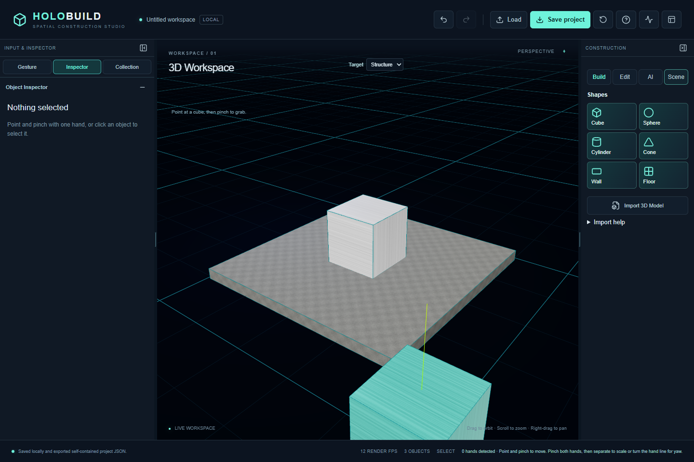
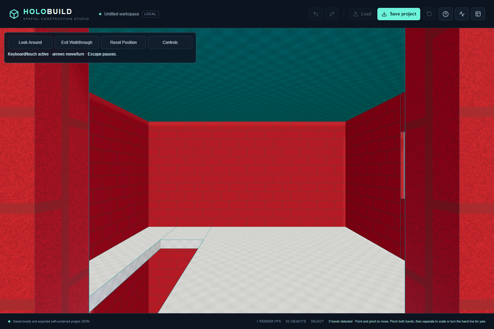

# HoloBuild

**Gesture-controlled 3D construction · Made by Aaryan · GitHub: Depsodent**

A local-first 3D editor with webcam gestures, mouse tools, voice/text commands and validated AI structure previews. React, TypeScript, Three.js/React Three Fiber and Zustand share one command/history system. Camera landmarks are processed locally; AI requests use a server-side provider adapter.

## Features

- Cubes, spheres, cylinders, cones, walls and floors; move, rotate, scale, duplicate and delete.
- Native standalone/connected stairs, balcony access and editable segmented door/window openings.
- Contextual object/structure inspectors, custom colors, PBR presets, procedural textures and studio lighting.
- Local GLB/GLTF import, portable versioned JSON projects, atomic Undo/Redo and conservative placement checks.
- Automatic one-hand movement and two-hand scale/yaw, calibrated pinch handling, GPU/CPU fallback and measured diagnostics.
- **Target Part / Structure** applies consistently to viewport clicks, gestures and Collection rows. Structure transforms affect all members in one history entry.
- Resizable sidebars, persistent left tabs and floating camera/diagnostics; Stop Camera remains reachable when minimized.
- Unified Ask HoloBuild: deterministic text/voice commands, Offline templates, optional local Ollama and native server-side Gemini generation/editing.
- AI preview → explicit confirmation → one undoable action. Invalid geometry is rejected, never silently repaired. Auto fallback is explicitly labeled Offline.
- Four-control Walkthrough with grounded Jump, held Sprint and contextual Furnish; exit restores the editor view.
- 45 native furniture/interior presets across six categories, validated floor/tabletop/wall/ceiling attachment, Inspector/gesture/AI edits and portable exact history.



## Local setup

Use Node 22.12+ or Node 24 LTS and npm. The active development checkout is `D:\Projects\HoloBuild`; historical relocation notes are retained in documentation.

```powershell
npm.cmd ci
npm.cmd run setup:vision
npm.cmd run dev -- --port 5175
```

Open the actual URL Vite prints. Camera/microphone require localhost or HTTPS and explicit permission. MediaPipe assets are downloaded once from Google with SHA-256 verification, then served locally. Collapsing the preview keeps tracking active; hiding the browser tab stops capture safely.

Start both local services with npm.cmd run dev:local (or npm.cmd run dev:gemini for the ignored Gemini profile). These helpers reuse healthy services and preserve their existing configuration.

No API key is needed for Offline editing/generation. For optional local Ollama, use a private `.env` based on `.env.example`, set the exact installed `LLM_MODEL`, and run `npm.cmd run planner` separately. No model is downloaded by the planner.

For Gemini, enter `GEMINI_API_KEY`, `LLM_PROVIDER=gemini` and an account-verified `GEMINI_MODEL` directly in ignored `.env.gemini.local`. Never use `VITE_` for credentials or paste keys into source/chat. `npm.cmd run check:gemini` lists account-supported model IDs without generating. Start with `node --env-file-if-exists=.env.gemini.local server/index.mjs`. See [deployment and security](docs/DEPLOYMENT.md).

## Controls

Click/select or point/pinch to grab; move while pinched, release to place. In Auto, two stable pinches prepare scale/yaw without a mode switch. Lost/ambiguous tracking cancels previews safely. V/G/R/S select mouse tools; Delete removes; Ctrl+Z / Ctrl+Shift+Z undo/redo. Target Part edits one component; Target Structure resolves its parent. Stop Camera is in the top bar and compact camera controls.

Save exports self-contained JSON, including imported assets. Browser-local assets use IndexedDB; changing origin or clearing storage can remove local references, so keep exported backups. See [manual tests](docs/MANUAL_TESTS.md), [workspace](docs/WORKSPACE.md), [commands](docs/COMMANDS.md) and [structure editing](docs/STRUCTURE_EDITING.md).

## Architecture and limits

Serializable scene state lives in Zustand; all committed edits use the command manager. Mouse, gestures, inspector and AI share scene validation and history. Providers return allowlisted construction/edit data, never executable code. The browser calls relative `/api/planner/*` endpoints. Ollama is loopback-only by default; hosted mode requires Gemini and distributed abuse limits.

Placement uses conservative transformed bounds rather than exact mesh collision. One-hand dragging uses a horizontal plane, not depth sensing. Import budgets are 10 MiB/250,000 triangles per bundle and 20 MiB of project assets; static uncompressed glTF only. Plans have at most 120 parts, 1,200-character prompts and bounded scene dimensions. AI output is a visual model, not engineering advice. Speech-recognition support and privacy depend on the browser/service.

See [architecture](docs/ARCHITECTURE.md), [performance](docs/PERFORMANCE.md), [AI generation](docs/AI_GENERATION.md) and [development/validation](docs/DEVELOPMENT.md). Physical acceptance is recorded only when confirmed by the user.

## Validation

```powershell
npx.cmd tsc -b --pretty false
npm.cmd run lint
npm.cmd test
npm.cmd run test:server
npm.cmd run build
$env:PLAYWRIGHT_CHANNEL='msedge'
$env:PLAYWRIGHT_BASE_URL='http://127.0.0.1:5175'
npm.cmd run test:e2e
node scripts/audit-publication.mjs
```

Alternatively install Playwright Chromium and omit the channel override. Browser tests are serial. Synthetic landmark/video tests exercise the real controller path but do not prove physical webcam usability. `?testInput` hooks exist only in development builds.

## Publication and licensing

Public website: **[holobuild.vercel.app](https://holobuild.vercel.app)**. Repository: **[Depsodent/HoloBuild](https://github.com/Depsodent/HoloBuild)**. Published with explicit owner approval. Vercel serves the frontend and native Gemini endpoints together; credentials are protected server-side, with distributed Upstash quotas. Public AI was enabled only after staged security/quota checks and owner confirmation of free-tier billing. See the [deployment record](docs/DEPLOYMENT.md).

Original project code is **UNLICENSED**: public visibility does not grant an open-source license. Author credits remain intact. See [third-party notices](THIRD_PARTY_NOTICES.md); build-generated full dependency notices are served at `/third-party-notices/index.json`. No personal imported models, private environment files, model weights or generated build/test artifacts are committed.

## Precision construction (Milestone 11)

Inspector sub-tabs: **Materials**, **AI Edit**, **Advanced**. Edit roughness/metalness/opacity, preset/color and precise local dimensions/world position; numeric changes commit on Enter or blur. AI Edit shares the existing conversation, validated previews and confirmation. Examples: Set roughness to 0.3; Set this window opacity to 50%; Move this object 20 centimeters to the right. Ambiguous requests retain the conversational planner path.

Choose grid increments 0.05–1 m for mouse/gesture placement and whole structures. Explicit numeric dimensions/positions remain exact. Optional measurement/alignment overlays are transient and not saved. Standalone, axis-aligned box faces support exact edge alignment; floor alignment uses actual supported floor surfaces or ground. Connected facades/assemblies retain their parameter controls; unsafe free edits are rejected.

**Build → Stairs / Balcony** uses the existing native architectural recipes. Choose a compatible multi-floor building, destination floor and dimensions/materials, then preview and confirm. Stairs cut a real destination-floor opening and require matching elevation/landings. Balconies create or reuse an aligned static doorway. Select a Part in Collection to edit its Materials / AI Edit / Advanced controls. Duplicate stairs to an unused adjacent-floor connection; balconies duplicate to the opposite facade. Both operations validate before committing. Standalone Stairs is also available without a host: configure real step dimensions and supported base elevation. It creates no inferred landing or slab opening. Balconies require a host; multiple connected stair voids on one destination floor remain unsupported. Geometry is a visual design model, not structural or regulatory certification.

### Simplified Walkthrough (Milestone 13)



Automated production capture in Edge with software rendering; physical-device acceptance remains pending.

The primary toolbar contains only **Look Around | Exit Walkthrough | Reset Position | Controls**. WASD/arrows and pointer lock retain native wall/floor, doorway, stair and balcony collision. Optional keyboard/touch fallback lives inside Controls help. The global Stop Camera remains accessible. Exit restores camera/layout/selection without changing history; explicitly confirmed furnishing persists. See [Walkthrough](docs/WALKTHROUGH.md), [project overview](docs/PROJECT_OVERVIEW.md) and [contributing](CONTRIBUTING.md).

For Jump/Sprint and furniture placement, see [Furnishing](docs/FURNISHING.md). Current validation/deployment receipts are recorded in the Milestone 13.1 handoff. Older milestone receipts are historical evidence, not current UI instructions. Physical webcam/microphone/friend-device acceptance remains pending until confirmed.
