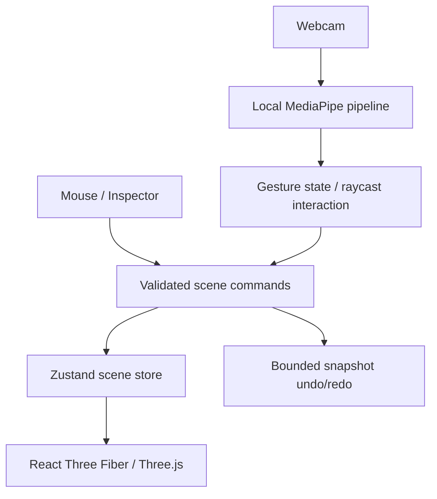

# Implemented architecture

## Foundation

`scene/objectTypes.ts` defines the persisted object schema: UUID, name, cube geometry, position, Euler rotation in radians, scale, color and material. Numeric positions/rotations must be finite and within ±100; scale is 0.1–20. `commandManager.ts` clones the current scene, applies one command, validates the whole result, and commits atomically. A rejected command changes status only. At most 200 objects are allowed, with unique IDs.

History retains up to 80 snapshots. This favors understandable, reliable reversal over memory efficiency. Each transform handle commits on release, not on every mouse movement. A fresh command clears redo. Selection/tool changes do not pollute history. Scene JSON has a version field; oversized, malformed, incompatible, or duplicate-ID files are rejected before mutation.

`BuildingObject.tsx` renders controlled scene data and temporary Drei transforms. Mouse-up turns the final transform into a command. `Scene.tsx` contains a perspective camera, orbit controls, lights, shadow-receiving ground and grid. An edge overlay communicates selection without postprocessing overhead. Inspector angles display degrees but store radians.

The shell subscribes only to scene fields it displays, so transient gesture previews do not rerender the whole application. Raw camera landmarks and full-rate gesture frames live in module streams outside React. The cursor updates its DOM position through a ref; only the ghost renderer observes transient preview state. Performance counters update at 1 Hz.

## Gesture interaction

`coordinateMapping.ts` maps mirrored screen coordinates to normalized device coordinates: `(2x−1, 1−2y)`. `raycasting.ts` uses the current Three.js perspective camera to select the nearest construction mesh, filtering by its object ID. The same ray intersects a horizontal plane through the grabbed cube's center. A captured grab offset prevents a jump when the cursor first grabs an off-center point.

`GestureController` requires an observed open pinch before accepting a debounced pinch edge. Strict pointing classification is not required. A recent actual ray hit is retained for at most 500 ms and 0.08 normalized cursor displacement during closure. Its grab session owns only object ID, height and offset. Subsequent stable pinches compute a candidate position and update transient preview state. They never change persisted object transforms. Debounced thumb/index release, independently of other finger pose changes, revalidates placement and calls `placeObject`, which routes through the same validated `execute(update)` command as the mouse inspector. Only that commit enters history. A fist release cancels; an ambiguous relaxed pose can place. UI overlays and mouse pointer-down cancel active grabs. A held pinch cannot restart a cancelled operation.

`placement.ts` snaps X/Z then transforms a unit cube's bounding box by its scale, rotation quaternion and translation. Axis-aligned bounds provide conservative overlap checks with 0.02 m tolerance; touching is permitted. Rotated cubes may be rejected even when their actual surfaces do not touch. Ground and ±50 m position limits apply to gesture placement. This is deterministic construction validation, not physics.

The renderer subscribes to gesture frames and cancels a grab on missing/invalid points, inactivity beyond 250 ms, viewport departure, scene/selection/tool changes or mouse pointer-down. On a scene edit, cancellation is checked even if that edit already cleared the preview. Grab setup changes selection/tool before opening the transaction, so its own setup is not mistaken for an external edit. Orbit controls are disabled only during a gesture grab.

Only Help → Open gesture tools opens the DOM tool menu; open-palm recognition has no menu side effect; pointer coordinates identify a card, and a later point/pinch edge invokes its shared command. High-frequency gesture inference remains independent of any future AI parser.

## Milestone 5 construction architecture

`objectTypes.ts` declares the six supported primitive types; `objectFactory.ts` owns their display names and base dimensions. `ObjectGeometry` is reused by real meshes and the gesture ghost, so render/pick/preview shapes agree. Stable object IDs and the existing raycaster work for every type. Recognition, thresholds, debounce, closure retention and Help-only menu activation are unchanged.

`placement.ts` computes world bounds from primitive dimensions, rotation and nonuniform scale. Boxes use transformed corners; spheres use ellipsoid support extents; cylinders use radial/axial support; cones use base-disc/apex support. Collision uses overlapping world AABBs with 0.02 m tolerance, so it is conservative rather than exact mesh intersection. Ground and ±50 m limits apply to whole bounds. Touching surfaces are permitted.

The existing `execute` create/update/duplicate commands now use that same validator. Creation/duplication search deterministic nearby grid positions. A rejected transform changes neither objects nor history. A mouse gizmo restores its actual mesh from committed state after snapping/rejection. Grounded rotation/scale preserves bottom height; explicit vertical movement is unchanged. JSON remains version 1 with an expanded type enum, preserving old cube scenes. Import validates structure/IDs/types, not collision layout, to avoid destroying legacy scenes.

## Milestone 5.1 floating camera and material rendering

The camera panel's layout module/hook owns only local UI geometry and minimized state; it does not own camera lifecycle or scene history. Resizing uses the viewport's bounds and never moves the toolbar/inspector. Hidden/minimized body content stays mounted. Header/corner pointer interactions reuse the scene's existing mouse-takeover cancellation so an active gesture preview cannot place an object while the window is dragged.

Preset IDs remain `solid` / `glass` in scene JSON. The centralized optical preset table configures MeshPhysicalMaterial without overwriting per-object color. A locally generated RoomEnvironment is convolved with PMREM and assigned to the scene environment, with complete teardown disposal. The ground uses a lit Lambert material without environment reflections, so reflections improve object appearance without brightening the workspace. Scene commands, serializer and gesture recognition are unchanged.

## Milestone 6 input and transaction flow

MediaPipe emits up to two raw hand arrays plus labelled handedness metadata. `HandRecognizer` assigns spatially continuous IDs and runs independent instances of the existing smoother and detector. `handsStream` carries both recognized hands; `gestureStream` carries the retained primary hand for compatibility. Loss/replacement or ambiguity cancels operations instead of silently transferring them.

Explicit advanced mode gates the old one-hand controller, two-hand transform controller and one-hand navigation controller. A two-hand session captures object snapshot, reference distance/angle and stable IDs. Preview scale/rotation/ground position is computed from that immutable snapshot, validated through the existing placement helper, then committed once through `execute(update)`. Quaternion world-Y rotation preserves correct orientation even for tilted objects. Mode/scene/input/mouse changes cancel. Camera pan captures position/OrbitControls target, changes only view state, and restores it on cancellation.

The independent menu FSM defaults off and requires sustained palm, neutral rearm, manipulation guard and cooldown. Mouse/UI activity suppresses it. Menu cards use the existing cursor/menuHit/pinch-confirm path and shared command/mode intents. A GUI/HUD/guide layer reads throttled hand state and transient transaction feedback; it owns no persistent scene data.

## Milestone 6.1 adaptive workspace

`WorkspaceLayout` composes the persistent camera/inspector left split, central scene, right construction toolbar and independent floating diagnostics. Grid column sizes release space on collapse. `ResizeHandle` uses captured pointer events and keyboard arrows; `ResizeObserver` measures available workspace bounds. The existing R3F canvas observes its resized parent rather than being recreated. Drawer layouts on narrow screens preserve canvas access and keep both sidebars reachable from compact rails.

`workspace/layoutStore` is a separate Zustand UI store with validated Local Storage preferences; it never writes scene state or command history. Camera and diagnostics share `useFloatingPanel` with independent keys, defaults and workspace boundary selection. Camera minimized state is controlled by workspace preferences, so docking and floating views share one source of truth. The video/tracker stay in the same mounted component and DOM location; CSS changes between static docking and absolute floating geometry. Camera/inspector/toolbar/diagnostics bodies scroll independently. Hiding a body or sidebar does not stop inference.

The Reset Workspace Layout action resets UI preferences and sends a reset event to mounted floating hooks, preserving capture and scene contents. Pointer/keyboard layout handles use existing mouse takeover/cancellation, prevent propagation to the canvas and suppress the opt-in menu until normal neutral rearm. No gesture recognition or scene transaction implementation is forked. Footer hints read throttled hand/mode state and present full text through accessible labels/tooltips.

## Milestone 7 surfaces and model assets

`materialPresets` retains legacy IDs while defining nine PBR profiles. Optional validated `surface` overrides live on each scene object and participate in existing command snapshots. `SurfaceResources` owns four shared procedural DataTextures with scene-lifetime cleanup. `SurfaceMaterial` compiles triplanar texture projection and a lightweight holographic scan highlight into MeshPhysicalMaterial; physical scene-unit positions include nonuniform object scale. Inspector parameters never touch tracking or gesture streams. `lightingStore` separately owns validated view preferences; serialization may include lighting but object history does not.

`assets/assetTypes` validates immutable bounded file bundles and SHA-256 identities; `assetStorage` persists them in IndexedDB. `modelLoader` validates references, lazily loads GLTFLoader, bakes static node transforms into normalized geometry, preserves original PBR resources and reports bounds/triangle/resource estimates. `modelRegistry` caches bundles/templates, retains resources referenced by scene/history, and disposes unreferenced GPU data. Duplicates share asset IDs and geometry; metadata snapshots never contain model buffers or Three.js objects.

The `model` scene type carries an asset ID, normalized dimensions and an original-material flag. `objectSize`, placement and ObjectGeometry's bounding proxy extend existing geometry handling. `BuildingObject` still owns the same transform ref, pointer selection and gizmo commit; ImportedModel renders immutable geometry under that root. Both mouse and gesture rays select the same proxy, and the existing controllers preview its bounds and commit normal updates. No model-only manipulation engine exists. The development-only seam can inspect real Three material parameters for browser regression checks; it is stripped from production.

`projectIO` stages and verifies model resources before one atomic object replacement. `assetOperation` prevents overlapping asynchronous imports/loads. Version-1 JSON adds optional assets/lighting and explicit local-reference metadata; primitive legacy files remain valid. Portable exports embed bounded base64 file bundles, while local metadata references IndexedDB. Missing assets/checksum/bounds/storage errors are visible and preserve objects/history. Local storage is origin-bound; portable exports are the durable transfer/backup path. Resource limits and unsupported formats are documented in DEVELOPMENT.md.

## Milestone 7.1 readiness, scheduling and UI state

Scale/Rotate use retained scene selection. With no selection and exactly one hand, the shared `GestureController` runs a selection-only path using the existing raycaster and debounced pinch. `TwoHandController` remembers each stable identity's open-pinch readiness independently for four seconds. An incoming hand's stabilization does not erase the prepared first hand; active tracking loss still cancels within the existing 250 ms guard. Both active pinches capture a fresh reference transform/distance/angle. Preview validation and one-command release use the same scene controller/history as before.

`cameraSettings.FramePacer` shares unique media timestamps and drift-compensated deadlines between requestVideoFrameCallback and a RAF watchdog. `HandTracker` allows one inference in flight, ignores results from old capture/configuration generations and releases pending initialization on Stop. Main-thread CPU remains default. The optional worker transfers a single ImageBitmap to the same local MediaPipe CPU model; bounded timeout/abort/close paths dispose bitmaps, detector and worker. Profiles change capture constraints best-effort without remounting the camera. The existing smoothing, recognition/debounce, calibration and scene commands remain independent.

`performanceStore` collects bounded rolling samples outside React, publishing at most twice per second. Render, presentation, inference and gesture rates have separate clocks. Processing-to-render callback is not physical hand latency; capture-to-render requires compatible browser metadata and excludes GPU presentation. Unreliable skipped-frame metadata yields unavailable values. See PERFORMANCE.md for measurements and limitations.

`Accordion` uses native details/summary with a validated, separately persisted `accordionStore`. Closing sections does not unmount or stop the camera. Workspace dimensions, floating geometry, scene state and object history retain their prior owners. The single header Stop camera action reaches the mounted tracker even when its body/sidebar is hidden. UI headers and layout controls cancel active gesture previews without creating commands; they never dispatch scene pointer events.
