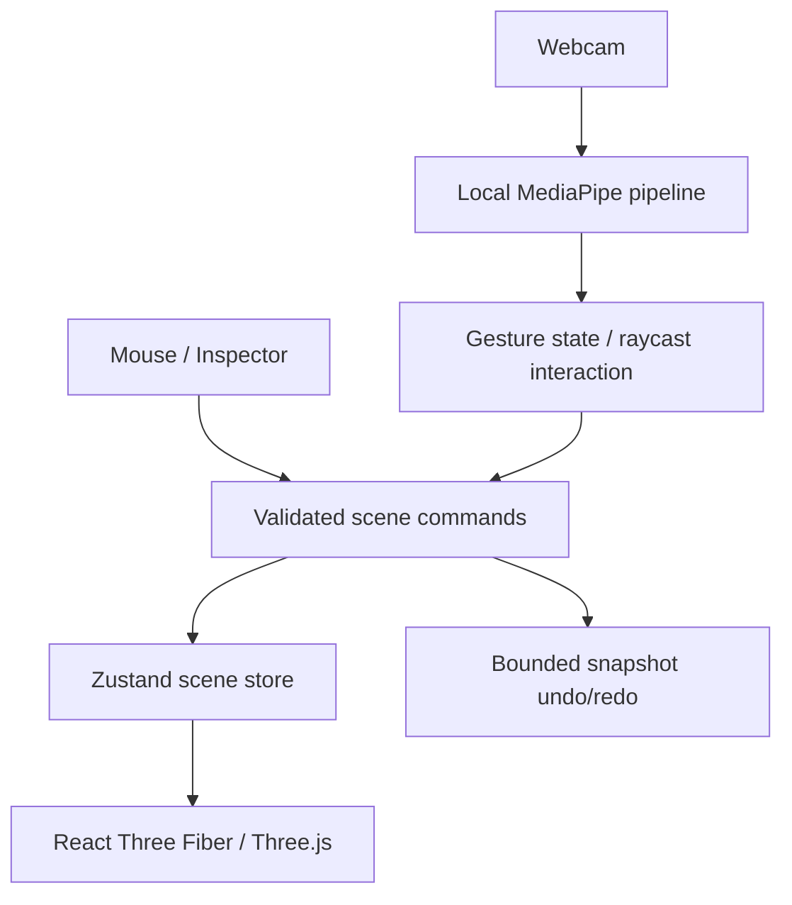

# Implemented architecture

## Foundation

`scene/objectTypes.ts` defines the persisted object schema: UUID, name, cube geometry, position, Euler rotation in radians, scale, color and material. Numeric positions/rotations must be finite and within ±100; scale is 0.1–20. `commandManager.ts` clones the current scene, applies one command, validates the whole result, and commits atomically. A rejected command changes status only. At most 200 objects are allowed, with unique IDs.

History retains up to 80 snapshots. This favors understandable, reliable reversal over memory efficiency. Each transform handle commits on release, not on every mouse movement. A fresh command clears redo. Selection/tool changes do not pollute history. Scene JSON has a version field; oversized, malformed, incompatible, or duplicate-ID files are rejected before mutation.

`BuildingObject.tsx` renders controlled scene data and temporary Drei transforms. Mouse-up turns the final transform into a command. `Scene.tsx` contains a perspective camera, orbit controls, lights, shadow-receiving ground and grid. An edge overlay communicates selection without postprocessing overhead. Inspector angles display degrees but store radians.

The small editor currently subscribes to scene state in the shell; raw camera landmarks will live outside React. Performance counters update at 1 Hz. Separation of vision and interaction is preserved as those milestones are introduced.
