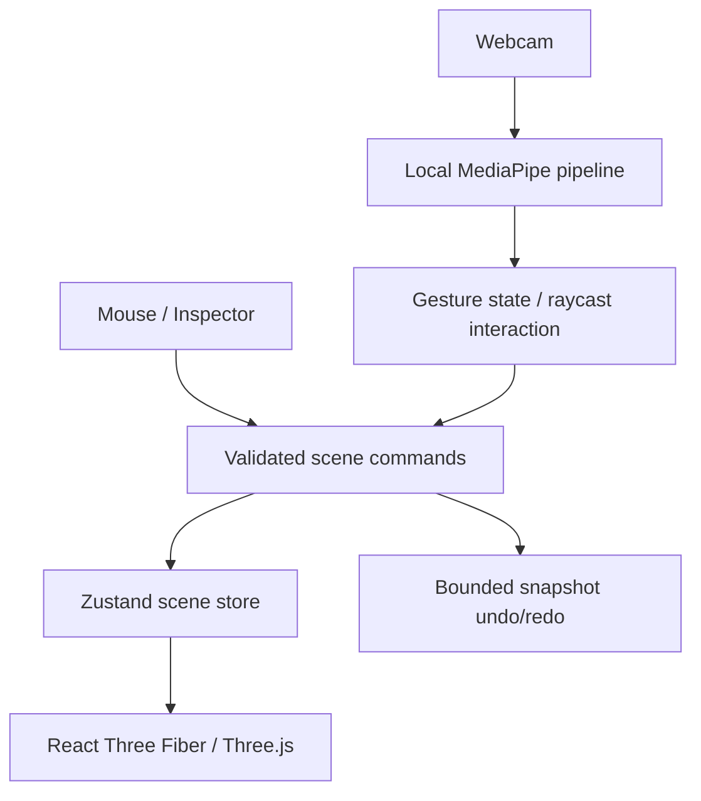

# Implemented architecture

## Foundation

`scene/objectTypes.ts` defines the persisted object schema: UUID, name, cube geometry, position, Euler rotation in radians, scale, color and material. Numeric positions/rotations must be finite and within ±100; scale is 0.1–20. `commandManager.ts` clones the current scene, applies one command, validates the whole result, and commits atomically. A rejected command changes status only. At most 200 objects are allowed, with unique IDs.

History retains up to 80 snapshots. This favors understandable, reliable reversal over memory efficiency. Each transform handle commits on release, not on every mouse movement. A fresh command clears redo. Selection/tool changes do not pollute history. Scene JSON has a version field; oversized, malformed, incompatible, or duplicate-ID files are rejected before mutation.

`BuildingObject.tsx` renders controlled scene data and temporary Drei transforms. Mouse-up turns the final transform into a command. `Scene.tsx` contains a perspective camera, orbit controls, lights, shadow-receiving ground and grid. An edge overlay communicates selection without postprocessing overhead. Inspector angles display degrees but store radians.

The shell subscribes only to scene fields it displays, so transient gesture previews do not rerender the whole application. Raw camera landmarks and full-rate gesture frames live in module streams outside React. The cursor updates its DOM position through a ref; only the ghost renderer observes transient preview state. Performance counters update at 1 Hz.

## Gesture interaction

`coordinateMapping.ts` maps mirrored screen coordinates to normalized device coordinates: `(2x−1, 1−2y)`. `raycasting.ts` uses the current Three.js perspective camera to select the nearest construction mesh, filtering by its object ID. The same ray intersects a horizontal plane through the grabbed cube's center. A captured grab offset prevents a jump when the cursor first grabs an off-center point.

`GestureController` requires stable pointing before accepting a pinch edge. Its grab session owns only object ID, height and offset. Subsequent stable pinches compute a candidate position and update transient preview state. They never change persisted object transforms. Stable release to pointing/open palm revalidates placement and calls `placeObject`, which routes through the same validated `execute(update)` command as the mouse inspector. Only that commit enters history. A fist/ambiguous release cancels.

`placement.ts` snaps X/Z then transforms a unit cube's bounding box by its scale, rotation quaternion and translation. Axis-aligned bounds provide conservative overlap checks with 0.02 m tolerance; touching is permitted. Rotated cubes may be rejected even when their actual surfaces do not touch. Ground and ±50 m position limits apply to gesture placement. This is deterministic construction validation, not physics.

The renderer subscribes to gesture frames and cancels a grab on missing/invalid points, inactivity beyond 250 ms, viewport departure, scene/selection/tool changes or mouse pointer-down. On a scene edit, cancellation is checked even if that edit already cleared the preview. Grab setup changes selection/tool before opening the transaction, so its own setup is not mistaken for an external edit. Orbit controls are disabled only during a gesture grab.

An open-palm edge opens a DOM tool menu; pointer coordinates identify a card, and a later point/pinch edge invokes its shared command. High-frequency gesture inference remains independent of any future AI parser.
